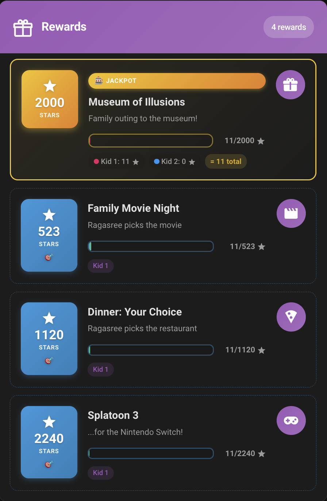
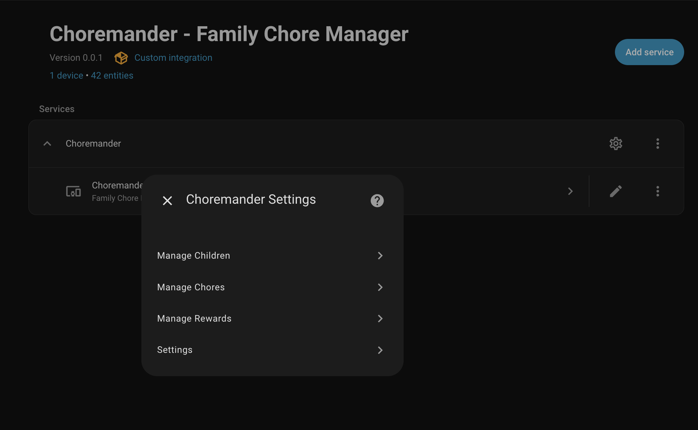
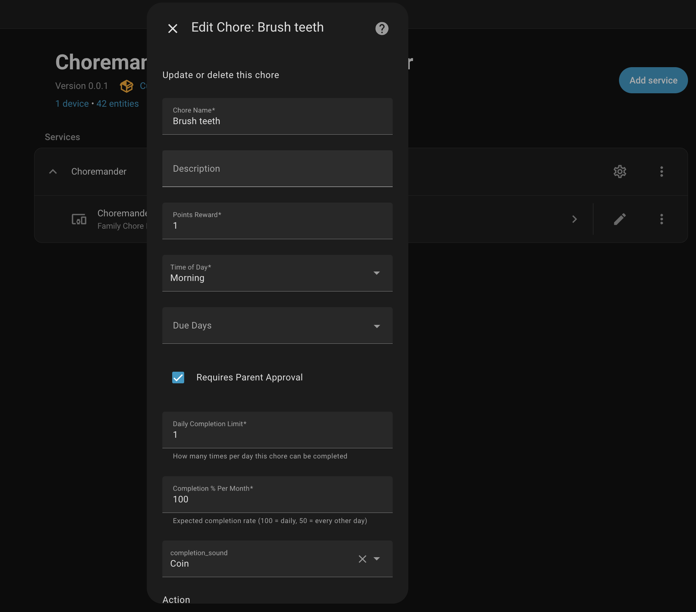
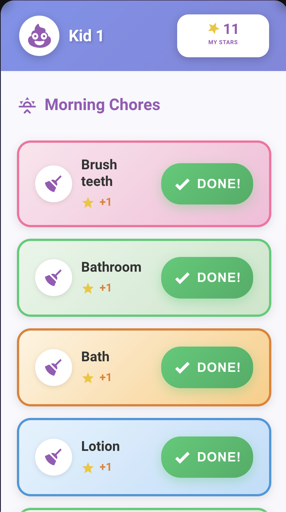
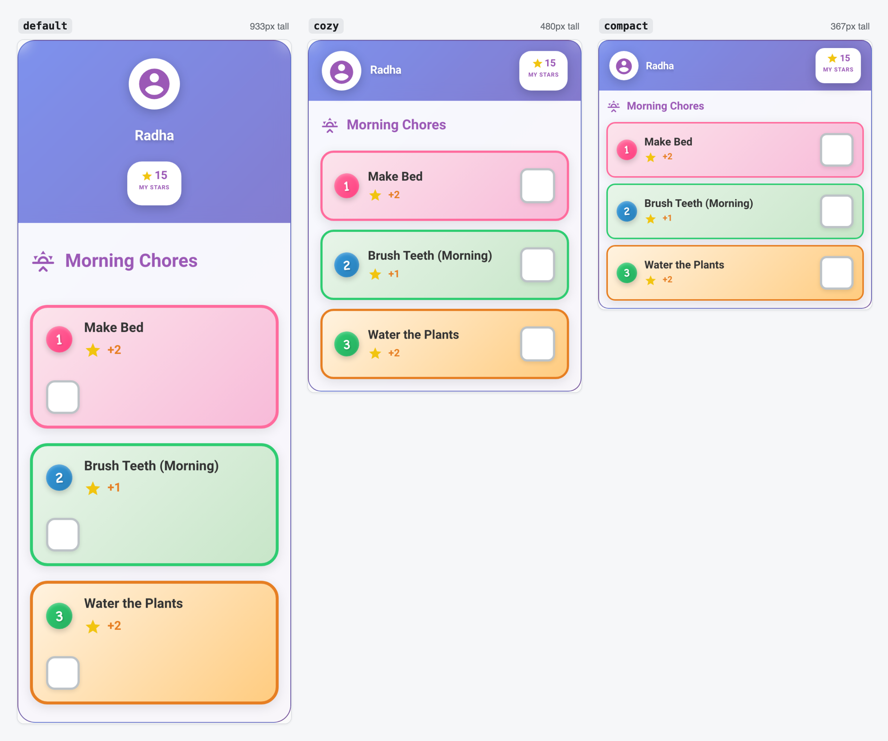
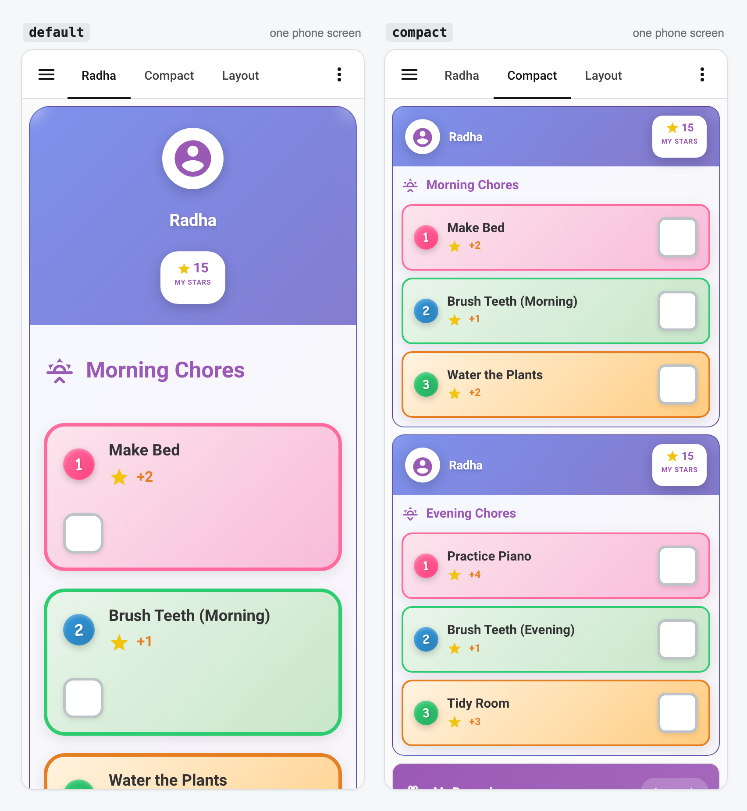
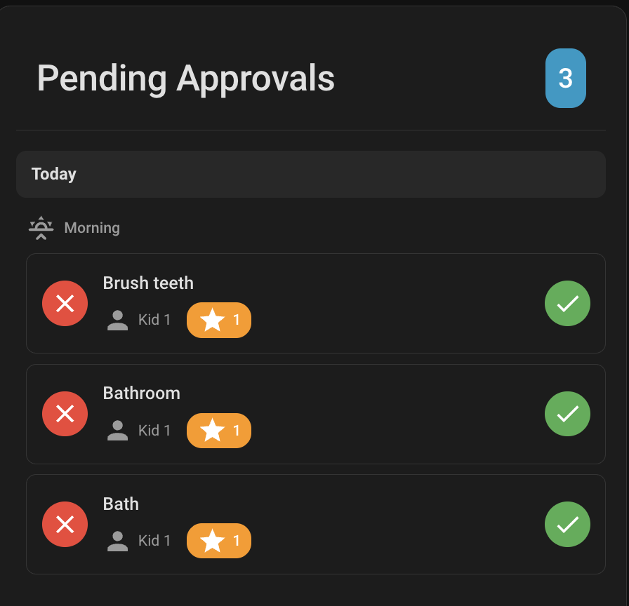

<p align="center">
  
</p>

<h1 align="center">Choremander</h1>
<p align="center">
  <strong>Turn chores into a game your kids actually want to play.</strong><br>
  A Home Assistant integration for family chore management with smart rewards.
</p>

---

## Contents

- [Why Choremander?](#why-choremander)
- [Quick Start](#quick-start)
- [Features](#features)
- [Dashboard Cards](#dashboard-cards)
- [Smart Reward Pricing](#smart-reward-pricing)
- [Tips](#tips)
- [Development](#development)

---

## Why Choremander?

Kids don't naturally love chores. But they *do* love games, progress bars, and earning things. Choremander turns daily responsibilities into a reward system that actually motivates.

### Build Better Habits Through Gamification

- **Visual progress** toward goals keeps kids engaged
- **Immediate feedback** (points, sounds, celebrations) reinforces positive behavior
- **Clear expectations** - kids know exactly what's required and what they'll earn

### Encourage the Right Behaviors

Not all chores are equal. Some are easy (brush teeth), others take effort (homework, practice). With Choremander:

- **Weight points by difficulty** - Give 1 star for easy tasks, 5 stars for harder ones
- **Harder chores = faster rewards** - Kids learn that putting in effort pays off
- **No gaming the system** - Smart pricing means you can't just spam easy chores to win

### Flexible Rewards That Make Sense

- **Per-child or shared** - Define rewards for one kid or assign to multiple
- **Smart pricing per child** - Even shared rewards calculate costs individually based on each child's chores and completion rates
- **Control the pace** - Set how many days a reward should take to earn; the system calculates the rest
- **Jackpot rewards** - Pool stars from all kids toward big family goals (vacation, museum trip, etc.)

<p align="center">
  
</p>

---

## Quick Start

### Install via HACS

1. **HACS** → Integrations → ⋮ menu → **Custom repositories**
2. Add `https://github.com/vinnybad/choremander` as an **Integration**
3. Search "Choremander" and install
4. **Restart Home Assistant**

### Configure

1. **Settings** → Devices & Services → **Add Integration** → "Choremander"
2. Choose your points currency (Stars, Coins, Bucks, etc.)
3. Click **Configure** on the integration to manage everything:

<p align="center">
  
</p>

---

## Features

### Chores

<p align="center">
  
</p>

| Feature | Description |
|---------|-------------|
| **Points** | Stars earned for completion |
| **Time of Day** | Morning, Afternoon, Evening, Night, or Anytime |
| **Completion % Per Month** | Expected completion rate (100 = daily, 50 = every other day) - used for smart reward pricing |
| **Daily Limit** | How many times per day the chore can be completed |
| **Requires Approval** | Parent must approve before points are awarded |

### Rewards

| Type | Description |
|------|-------------|
| **Dynamic** *(default)* | Cost auto-calculated: `Days to Goal` × expected daily earnings (based on each chore's points and completion rate) |
| **Fixed** | Toggle "Override Point Value" to set a manual cost |
| **Jackpot** | Pool stars from ALL assigned children toward one big family reward |

---

## Dashboard Cards

Cards auto-register when the integration loads. Just add them to your Lovelace dashboard - no manual resource configuration needed!

### Adding Cards (Visual Editor)

The easiest way to add Choremander cards:

1. Edit your dashboard and click **Add Card**
2. Search for the card (e.g., "choremander-child-card") or scroll to find it under "Custom"
3. Alternatively, add a **Manual** card and enter the card type (e.g., `custom:choremander-child-card`)
4. The card will show a configuration interface - enter the entity that card reads (see below)
5. Fill in any additional options (child selection, time of day, etc.) and save

Most cards read `sensor.choremander_overview`. Three read their own sensor
instead, because the data they need is too large to carry on the overview one:

| Card | Entity |
|------|--------|
| Approvals Card | `sensor.pending_approvals` |
| Activity Card | `sensor.choremander_activity` |
| Streak Card | `sensor.choremander_streaks` |
| Everything else | `sensor.choremander_overview` |

Picking the wrong one is not silent — the card says which entity it reads rather
than drawing an empty card.

> **Tip:** If the card shows an error after adding, click on it to open the configuration panel. This is normal - it just needs to be configured!

### Missing cards after installing Choremander?

Versions before this fix could delete the Lovelace resources belonging to your
*other* custom cards ([issue #2](https://github.com/vinnybad/choremander/issues/2)).
Choremander registered its own cards before Home Assistant had finished loading
the resource list, and saving that half-loaded list overwrote everything else in
it - on every restart, which is why re-adding the entries by hand never stuck.

That no longer happens. If you were affected, Choremander looks for the cards
your dashboards still reference but can no longer load, and offers to put them
back: go to **Settings → System → Repairs**. It shows you exactly which
resources it would restore before changing anything, and leaves alone anything
you have already re-added yourself. Reload your browser afterwards.

You can also restore them by hand under **Settings → Dashboards → ⋮ →
Resources**.

### YAML Mode Users

If you use Lovelace in YAML mode, add these resources to your `configuration.yaml`:

```yaml
lovelace:
  resources:
    - url: /choremander/choremander-child-card.js
      type: module
    - url: /choremander/choremander-rewards-card.js
      type: module
    - url: /choremander/choremander-approvals-card.js
      type: module
    - url: /choremander/choremander-points-card.js
      type: module
    - url: /choremander/choremander-reorder-card.js
      type: module
    - url: /choremander/choremander-activity-card.js
      type: module
    - url: /choremander/choremander-streak-card.js
      type: module
```

### Card Index

| Card | For | Description |
|------|-----|-------------|
| [Child Card](#child-card) | Kids | Kid-friendly chore completion interface |
| [Rewards Card](#rewards-card) | Kids | View available rewards and progress |
| [Streak Card](#streak-card) | Kids | Day streaks, recent activity and milestones |
| [Approvals Card](#approvals-card) | Parents | Approve or reject completed chores |
| [Points Card](#points-card) | Parents | Manually add/remove points |
| [Reorder Card](#reorder-card) | Parents | Organize chore display order per child |
| [Activity Card](#activity-card) | Parents | Timeline of everything that happened |

> **Tip:** Create separate dashboards - one for kids (Child + Rewards + Streak) and one for parents (Approvals + Points + Activity).

---

### Cards for Kids

#### Child Card

Kid-friendly interface with big colorful buttons and celebration sounds. This is the primary way children interact with their chores.

<p align="center">
  
</p>

**Visual Editor:** Add `custom:choremander-child-card`, then configure the entity (`sensor.choremander_overview`), select a child, and optionally filter by time of day.

<details>
<summary>YAML Example</summary>

```yaml
type: custom:choremander-child-card
entity: sensor.choremander_overview
child_id: a8c8376a
time_category: morning  # Optional: morning, afternoon, evening, night, anytime
title: My Chores        # Optional
density: compact        # Optional: default, cozy, compact
show_header: false      # Optional: hide the avatar / name / balance strip
```
</details>

The same card at each `density` — the chores and the child are identical, only
the option differs:

<p align="center">
  
</p>

What that adds up to on a phone. Same dashboard, one screen:

<p align="center">
  
</p>

<details>
<summary>Layout options</summary>

| Option | Values | Default | What it does |
|---|---|---|---|
| `density` | `default`, `cozy`, `compact` | `default` | How much space each chore takes. `compact` fits roughly twice as many chores on a phone screen. |
| `show_header` | bool | `true` | The avatar, name and star balance across the top. Turn off if you show the balance elsewhere. |
| `show_avatar` | bool | `true` | Just the round avatar. |
| `show_title` | bool | `true` | The "Morning Chores" heading. |
| `show_numbers` | bool | `true` | The coloured number badge on each chore. |
| `show_chore_points` | bool | `true` | The star value under each chore name. |
| `animations` | bool | `true` | The floating avatar and spinning stars. Celebrations still play. |

Tap targets do not shrink with density: a chore row stays at least 56px tall
and the checkbox at least 40px at every setting, because the whole row is the
button and it is a small child doing the tapping. The card also honours your
operating system's "reduce motion" setting on its own.

</details>

#### Rewards Card

Shows all available rewards with progress bars. Displays dynamic pricing indicators and jackpot status.

**Visual Editor:** Add `custom:choremander-rewards-card`, configure the entity, and optionally filter to a specific child.

<details>
<summary>YAML Example</summary>

```yaml
type: custom:choremander-rewards-card
entity: sensor.choremander_overview
child_id: 6ddfca70  # Optional: filter to specific child
density: compact    # Optional: default, cozy, compact
animations: false   # Optional: stop the shimmer and jackpot shine
```
</details>

---

#### Streak Card

How many days in a row each child has kept going, a strip of dots for the recent
days they were active, and the milestones they have reached. Streaks are worked
out from the chores that were actually approved, so the number and the dots can
never tell different stories.

A day counts once, however many chores were done in it, and a streak stays alive
until a whole day has been missed - so it does not appear to collapse the moment
the clock passes midnight.

**Visual Editor:** Add `custom:choremander-streak-card` and pick the streaks
entity.

<details>
<summary>YAML Example</summary>

```yaml
type: custom:choremander-streak-card
entity: sensor.choremander_streaks
title: Streaks
child_id: a8c8376a       # optional: one child instead of the whole family
streak_days: 14
achievements: next
```
</details>

<details>
<summary>Options</summary>

| Option | Default | Description |
|--------|---------|-------------|
| `entity` | required | The `sensor.choremander_streaks` entity |
| `title` | `Streaks` | Header text |
| `child_id` | all | Show one child instead of the whole family |
| `streak_days` | `14` | Days in the dot strip, up to 30 |
| `achievements` | `next` | `next` (earned plus one to aim for), `earned`, `all` or `none` |
| `show_avatar` | `true` | Show each child's avatar |
| `density` | `default` | `default`, `cozy` or `compact` |
| `animations` | `true` | Scales up today's dot |

</details>


### Cards for Parents

#### Approvals Card

Review and approve (or reject) completed chores that require parent approval. Shows pending items grouped by time of day.

<p align="center">
  
</p>

**Visual Editor:** Add `custom:choremander-approvals-card` and configure the
entity (`sensor.pending_approvals`). This card reads its own sensor, not the
overview one — pointed anywhere else it shows "All caught up!" no matter what is
waiting.

<details>
<summary>YAML Example</summary>

```yaml
type: custom:choremander-approvals-card
entity: sensor.pending_approvals
```
</details>

#### Points Card

Manually add bonus points (great job today!) or remove points (consequences). Useful for situations outside the normal chore flow.

**Visual Editor:** Add `custom:choremander-points-card` and configure the entity.

<details>
<summary>YAML Example</summary>

```yaml
type: custom:choremander-points-card
entity: sensor.choremander_overview
```
</details>

#### Reorder Card

Drag-and-drop interface to organize the order chores appear for each child. Customize the experience per kid.

**Visual Editor:** Add `custom:choremander-reorder-card`, configure the entity, and select a child.

<details>
<summary>YAML Example</summary>

```yaml
type: custom:choremander-reorder-card
entity: sensor.choremander_overview
child_id: a8c8376a
```
</details>

#### Activity Card

A timeline of everything that has happened: chores done and approved, rewards
claimed, and the bonuses and penalties you handed out - with the reason you gave
for each. Answers "why does she have that many stars?" without guesswork.

Chores waiting on your approval appear too, marked as such, showing what they
are worth rather than a change that has not happened yet.

**Visual Editor:** Add `custom:choremander-activity-card` and pick the activity
entity. Everything else is optional.

<details>
<summary>YAML Example</summary>

```yaml
type: custom:choremander-activity-card
entity: sensor.choremander_activity
title: Activity
child_id: a8c8376a    # optional: one child instead of the whole family
max_items: 20
density: compact
```
</details>

<details>
<summary>Options</summary>

| Option | Default | Description |
|--------|---------|-------------|
| `entity` | required | The `sensor.choremander_activity` entity |
| `title` | `Activity` | Header text |
| `child_id` | all | Show only one child's activity |
| `max_items` | `20` | Events to show. The integration keeps the most recent 40 |
| `show_filters` | `true` | Chips to narrow to chores, rewards or bonuses |
| `show_relative_time` | `true` | "20m ago" for recent events instead of a clock time |
| `density` | `default` | `default`, `cozy` or `compact` |
| `animations` | `true` | Hover and press transitions on the filter chips |

</details>

---

> **Note:** Most cards read the `sensor.choremander_overview` entity. The Activity
> Card reads `sensor.choremander_activity` and the Streak Card reads
> `sensor.choremander_streaks` - both are created for you. Child-specific cards
> also need a child selection.

---

### Custom Styling

If `density` does not get you where you want, the Child, Rewards, Activity and
Streak cards expose every size as a CSS custom property. Set one anywhere above the card - a
Home Assistant theme, or a `card_mod` block on a single card - and it wins over
the built-in value.

```yaml
# In your theme, applying to every Choremander card at once
my_theme:
  chm-chore-min-height: 48px
  chm-chore-name-font-size: 1rem
  chm-card-background: "linear-gradient(135deg, #11998e 0%, #38ef7d 100%)"
```

```yaml
# Or with card_mod, on one card only
type: custom:choremander-child-card
entity: sensor.choremander_overview
child_id: a8c8376a
card_mod:
  style: |
    :host {
      --chm-chore-radius: 4px;
      --chm-color-purple: #e91e63;
    }
```

<details>
<summary>Child Card properties</summary>

| Property | Default |
|---|---|
| `--chm-card-background` | `linear-gradient(135deg, #667eea 0%, #764ba2 100%)` |
| `--chm-card-radius` | `24px` |
| `--chm-header-padding` | `20px 24px` |
| `--chm-avatar-size` / `--chm-avatar-icon-size` | `70px` / `50px` |
| `--chm-name-font-size` | `clamp(1.2rem, 5vw, 2rem)` |
| `--chm-balance-padding` / `--chm-balance-radius` | `12px 16px` / `20px` |
| `--chm-chores-padding` / `--chm-chores-gap` / `--chm-chores-min-height` | `24px` / `20px` / `200px` |
| `--chm-title-font-size` / `--chm-title-icon-size` | `1.8rem` / `36px` |
| `--chm-chore-padding` / `--chm-chore-min-height` | `20px 24px` / `80px` |
| `--chm-chore-radius` / `--chm-chore-border-width` | `24px` / `4px` |
| `--chm-chore-name-font-size` / `--chm-chore-points-font-size` | `1.5rem` / `1.2rem` |
| `--chm-badge-size` / `--chm-badge-font-size` | `42px` / `1.5rem` |
| `--chm-checkbox-size` / `--chm-checkbox-icon-size` | `44px` / `28px` |
| `--chm-color-pink`, `-purple`, `-blue`, `-green`, `-yellow`, `-orange`, `-red`, `-cyan` | the built-in palette |

</details>

<details>
<summary>Rewards Card properties</summary>

| Property | Default |
|---|---|
| `--chm-header-padding` / `--chm-header-title-font-size` | `16px 20px` / `1.3rem` |
| `--chm-content-padding` / `--chm-content-gap` | `16px` / `12px` |
| `--chm-reward-padding` / `--chm-reward-gap` / `--chm-reward-radius` | `16px` / `16px` / `12px` |
| `--chm-cost-badge-min-width` / `--chm-cost-badge-padding` | `70px` / `12px 8px` |
| `--chm-cost-value-font-size` / `--chm-cost-label-font-size` | `1.4rem` / `0.65rem` |
| `--chm-reward-name-font-size` / `--chm-reward-desc-font-size` | `1.15rem` / `0.9rem` |
| `--chm-progress-height` / `--chm-jackpot-progress-height` | `14px` / `18px` |
| `--chm-reward-icon-size` / `--chm-reward-icon-glyph-size` | `44px` / `24px` |

</details>

<details>
<summary>Activity Card properties</summary>

| Property | Default |
|---|---|
| `--chm-header-padding` / `--chm-header-icon-size` | `16px 20px` / `32px` |
| `--chm-header-title-font-size` | `1.4rem` |
| `--chm-activity-filters-padding` / `--chm-activity-chip-font-size` | `12px 20px 4px` / `0.85rem` |
| `--chm-activity-feed-padding` | `8px 20px 16px` |
| `--chm-activity-day-label-margin` / `--chm-activity-day-label-font-size` | `16px 0 8px` / `0.75rem` |
| `--chm-activity-event-padding` / `--chm-activity-event-gap` | `10px 0` / `12px` |
| `--chm-activity-event-min-height` | `56px` |
| `--chm-activity-icon-size` / `--chm-activity-icon-glyph-size` | `40px` / `22px` |
| `--chm-activity-text-font-size` / `--chm-activity-meta-font-size` | `0.95rem` / `0.78rem` |
| `--chm-activity-points-font-size` / `--chm-activity-points-icon-size` | `0.95rem` / `16px` |
| `--chm-color-green`, `-red`, `-orange`, `-purple`, `-blue`, `-cyan` | the event colours |

</details>

<details>
<summary>Streak Card properties</summary>

| Property | Default |
|---|---|
| `--chm-header-padding` / `--chm-header-icon-size` | `16px 20px` / `32px` |
| `--chm-streak-child-padding` / `--chm-streak-top-gap` | `16px 20px` / `14px` |
| `--chm-streak-avatar-size` / `--chm-streak-avatar-glyph-size` | `52px` / `30px` |
| `--chm-streak-name-font-size` / `--chm-streak-sub-font-size` | `1.1rem` / `0.9rem` |
| `--chm-streak-count-font-size` / `--chm-streak-best-font-size` | `1.9rem` / `1.1rem` |
| `--chm-streak-dot-size` / `--chm-streak-dot-gap` | `12px` / `5px` |
| `--chm-streak-badge-size` / `--chm-streak-badge-padding` / `--chm-streak-badge-radius` | `66px` / `8px 6px` / `12px` |
| `--chm-streak-badge-emoji-size` / `--chm-streak-badge-label-size` | `1.5rem` / `0.68rem` |
| `--chm-color-orange` / `--chm-color-green` | the fire and today colours |

</details>

If you set both, the `density` option wins - it is the more specific instruction.
To restyle a card that also uses a density, target `:host([density="compact"])`
in your `card_mod` block.

---

## Smart Reward Pricing

The goal: **every reward should take a predictable amount of time to earn** - not random guessing.

### The Problem with Fixed Prices

If you set "Family Movie Night" to cost 500 stars, how long does that take? A week? A month? You'd have to manually calculate based on all assigned chores... and recalculate every time you add or change one.

### How Smart Pricing Works

You set **Days to Goal** (e.g., 14 days). Choremander does the math:

1. Looks at each chore's **point value** and **expected completion rate**
2. Calculates how many points the child *should* earn per day
3. Sets the reward cost so it takes exactly that many days

```
Daily Expected Points = Sum of (Chore Points × Completion %)
Reward Cost = Daily Expected Points × Days to Goal
```

### Why This Encourages Better Behavior

Here's the key insight: **completion rate matters**.

If a child only does "Homework" 60% of the time but "Brush teeth" 100% of the time, the pricing reflects that. Kids who consistently do the *harder* chores will hit their goals faster than kids who only do the easy ones.

**The incentive:** Want that reward sooner? Do the challenging stuff, not just the minimum.

| Behavior | Result |
|----------|--------|
| Only does easy daily chores | Earns rewards at the expected pace |
| Tackles harder/optional chores | Earns rewards *faster* than expected |
| Skips difficult chores | Falls behind the expected pace |

### Jackpot Rewards

For big family goals (vacation, museum trip), enable **Jackpot** mode. All children's stars pool together toward one shared reward - teamwork!

---

## Tips

- **Two dashboards:** One for kids (Child + Rewards), one for parents (Approvals + Points)
- **Completion %:** Set lower for optional/weekly chores so they don't inflate reward costs
- **All data is local:** Nothing leaves your Home Assistant instance

---

## Development

### Testing Changes Locally

A full local environment is included: a real Home Assistant in Docker with
seeded family data, plus three test layers that run against it. Nothing touches
your real Home Assistant instance.

**See [docs/TESTING.md](docs/TESTING.md) for the complete guide.**

#### Requirements
- Docker and Docker Compose
- Python 3.13 and Node 20+ (only if you want to run the test suites)

#### Quick Start

```bash
make install    # venv, Python deps, Node deps, Chromium
make up         # start Home Assistant and wait until Choremander loads
make verify     # lint + unit tests + API e2e + browser e2e
```

`make up` is fully non-interactive: it starts the container, completes
onboarding over the REST API, creates the `dev` user, and blocks until the
integration has actually loaded. Log in at <http://localhost:8123> with
`dev` / `dev`.

Three dashboards are pre-configured in the sidebar:

| URL | Contents |
|---|---|
| `/krishna` | Kid dashboard — chores, progress, rewards |
| `/radha` | Kid dashboard |
| `/parent` | Approvals, points management, chore reorder |

#### Development Workflow

```bash
# After changing Python files:
make restart          # restarts and waits until it is serving again

# After changing JS card files, just hard refresh the browser (Cmd+Shift+R)

make test             # fast unit tests, no container needed
make e2e              # API-driven tests against the live container
make browser          # Playwright tests driving the real cards
make browser-headed   # ...and watch them run

make logs             # follow filtered container logs
make shell            # shell inside the container
make seed             # restore the seeded family data
make reset            # wipe all generated state
make down             # stop
```

Run `make help` for the full list.

#### Pre-configured Test Data

The dev environment comes with:
- **2 kids:** Krishna (25 stars) and Radha (15 stars)
- **8 chores:**
  - Shared: Make Bed, Brush Teeth (AM/PM), Tidy Room
  - Krishna only: Feed the Dog, Do Homework
  - Radha only: Water the Plants, Practice Piano
- **5 rewards:**
  - 30 Min Screen Time (dynamic pricing, 7 days) - shared
  - New Video Game (50 stars, fixed) - Krishna only
  - New Book (30 stars, fixed) - Radha only
  - Family Movie Night (jackpot, 14 days) - shared
  - Trip to the Zoo (jackpot, 30 days) - shared

---

<p align="center">
  <sub>License: MIT</sub>
</p>
